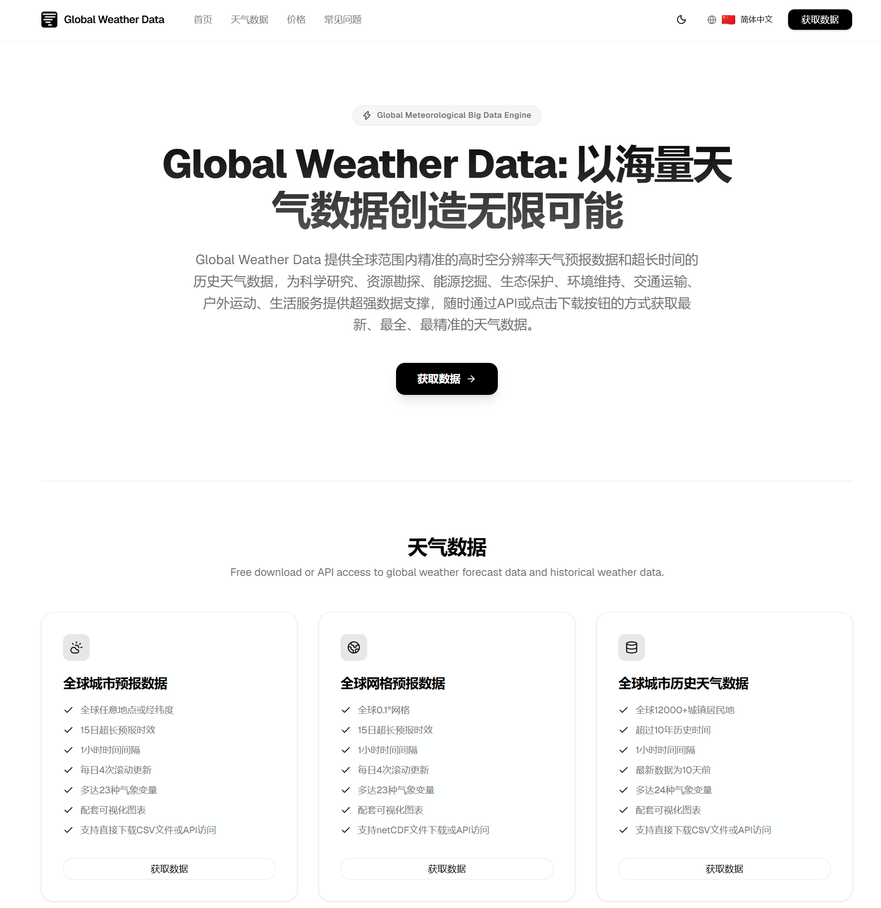
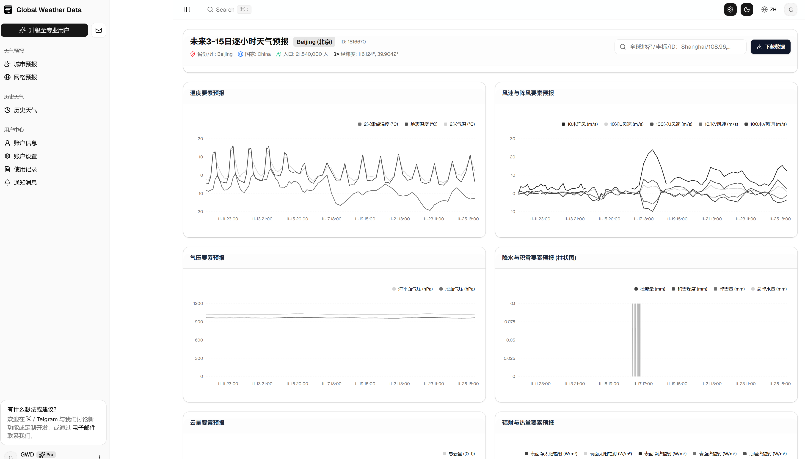
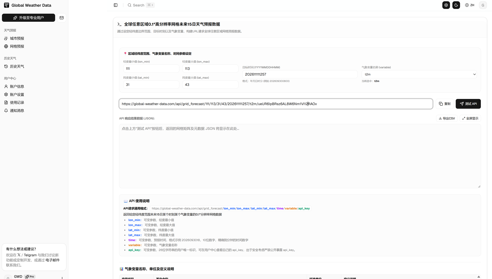
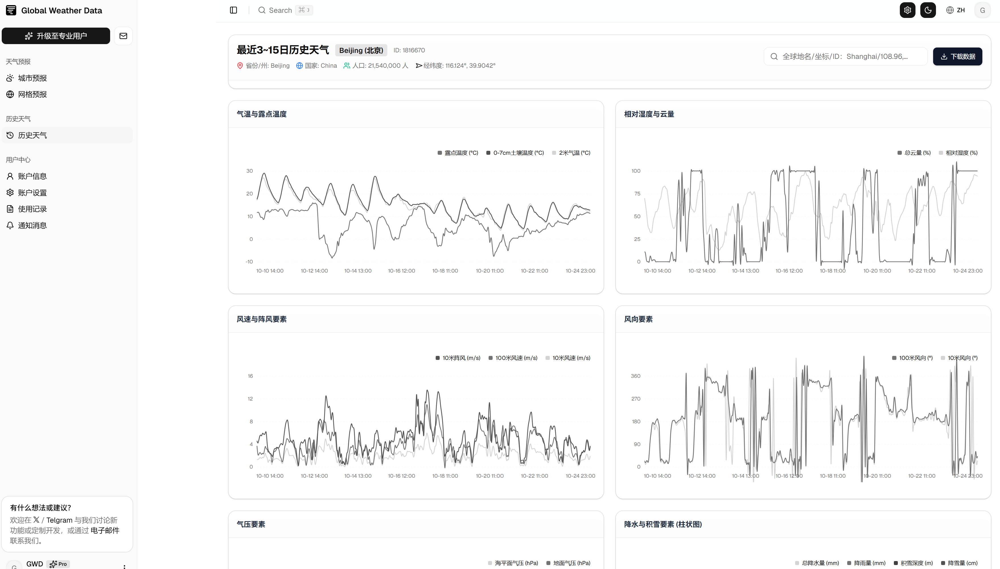
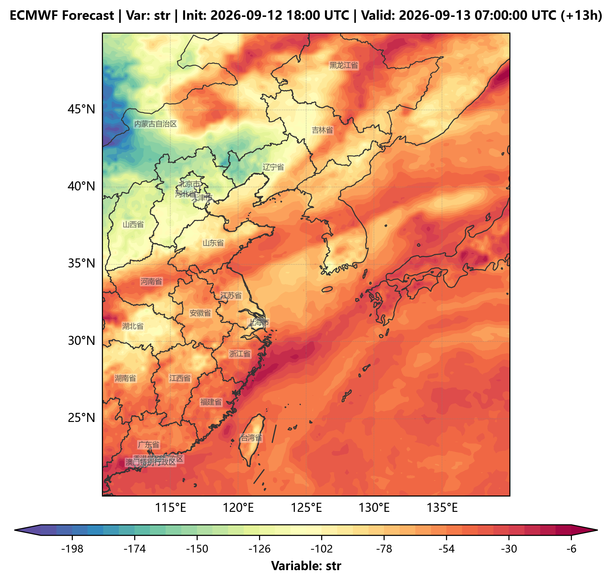
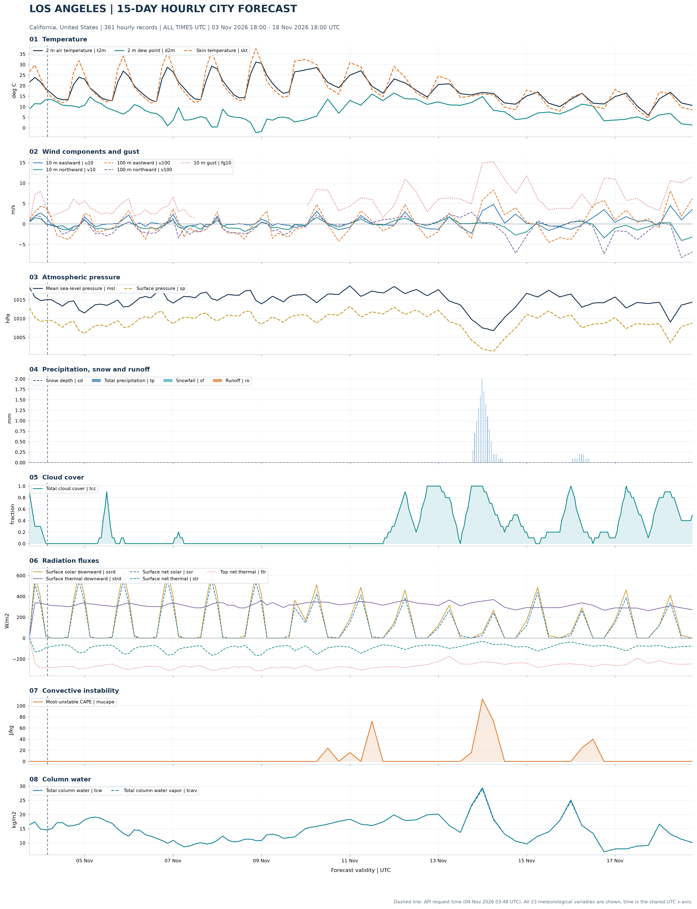
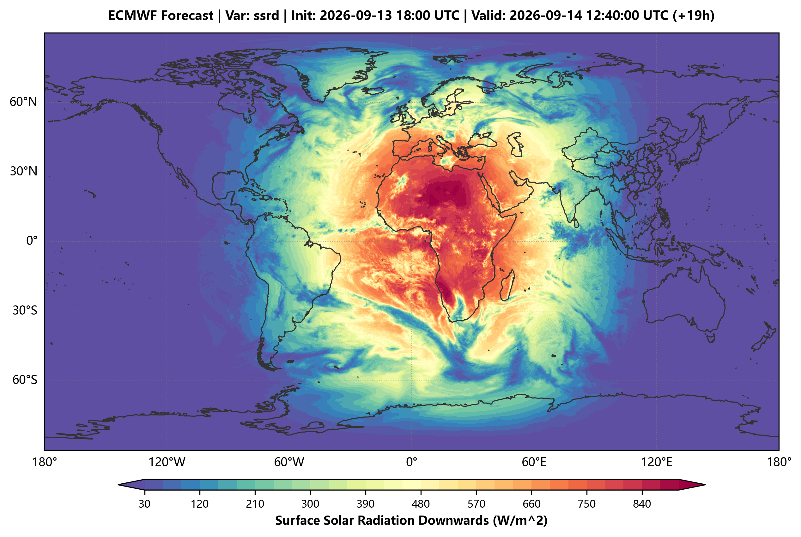
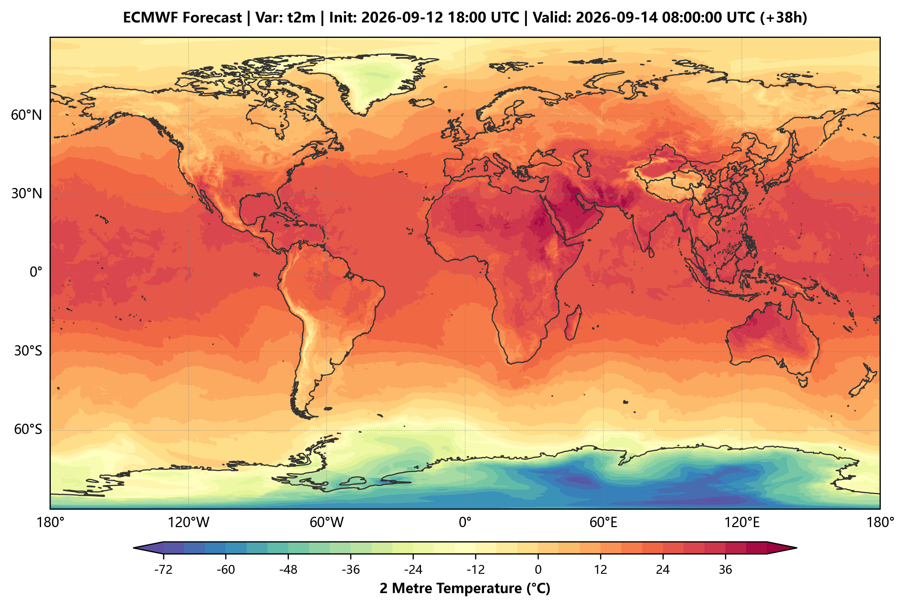
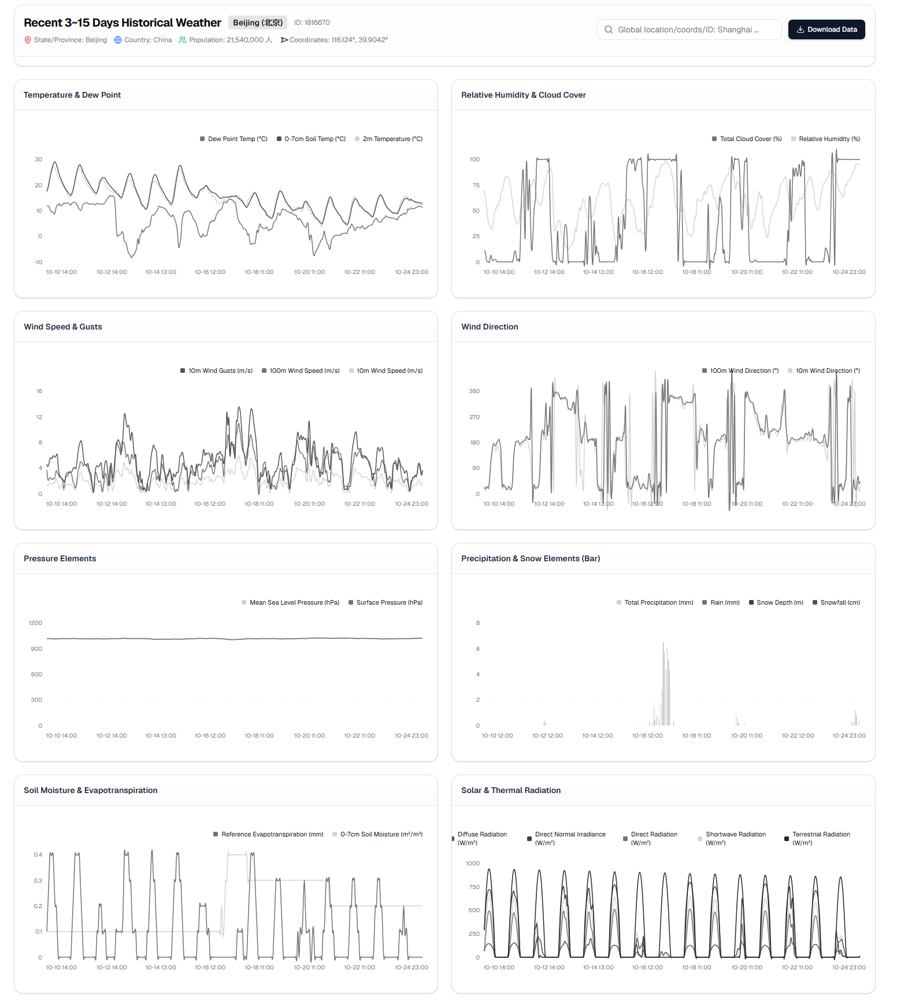

# Global Weather Data ：开源免费的全球气象数据库


<div align="center">

🌐 **[English](#-global-weather-data)** | 🇨🇳 **[中文简体](#-global-weather-data-使用指南)**

</div>

---

🌐 **官方网站：** [global-weather-data.com](https://global-weather-data.com/) 




Global Weather Data 是一个专注于全球天气预报数据与历史气象数据下载、查询及可视化展示的专业平台。旨在免费为全球开发者、研究人员及气象爱好者提供最便捷的数据获取途径，用户既可以通过网页端直接查看与下载 CSV 数据，也可以通过简洁高效 the RESTful API 在线调取全网气象数据。所有天气预报数据和历史天气数据均免费提供。

## 🚀 核心功能概述

* **城市天气预报：** 提供全球 12,000+ 个居民地（覆盖城镇与乡村）未来 15 天、逐小时、20+ 种气象变量的预报数据。

* **网格天气预报：** 提供全球 0.25° 分辨率的网格预报数据，覆盖未来 15 天逐小时空间网格，支持热力图绘制与模型训练输入。

* **历史天气数据：** 提供全球 12,000+ 城镇过去 10 年以上、逐小时、20+ 气象变量的长序列历史气象档案。

* **双模数据获取：** 支持网页端一键导出 CSV 格式数据，或通过 API 接口进行程序化自动调用。


## 📊 核心数据模块介绍

### 1. 城市天气预报数据

* **搜索与定位：** 顶部搜索栏支持全球任意语言地名、经纬度坐标或 GeoNames ID (`geonameID`) 进行智能检索，系统将自动匹配最精准的地点。

* **数据来源：** 依托 ECMWF 权威预报模型。

* **气象变量：** 提供气温、气压、风速、风向、相对湿度、太阳辐射、地温、土壤含水量、径流等 20 余种逐小时高分辨率气象要素。

* **获取方式：**

  * **网页可视化：** 实时加载未来 15 天趋势图表，点击右上角即可一键下载全量 CSV 数据。

  * **API 在线调取：** 页面下方提供实时 API 测试工具，支持通过地名、ID 或经纬度快速构建请求 URL。




### 2. 网格预报数据 (0.25° 网格)

* **空间网格查询：** 通过指定经纬度范围、气象变量与时间参数，获取全球任意区域的结构化网格预报。

* **应用场景：** 可直接加载地理边界绘制热力图、色斑图，或无缝导入气象与环境机器学习模型中进行训练。




### 3. 历史天气数据

* **长序列时空跨度：** 提供跨度长达 10 年以上、逐小时分辨率的精确历史气象记录。

* **数据来源：** 依托 ERA5 再分析资料（注：受限于数据发布周期，最新历史数据通常存在 7–10 天左右的入库延迟）。

* **灵活调用：** 通过调整API中的地点与天数参数，可自由获取过去几天、几十天乃至数年的连续逐小时气象档案。




## 🔌 API 快速上手

平台 API 设计轻量、开箱即用。只需指定目标地点（地名、ID 或经纬度）即可快速响应。

### 全球天气预报数据示例请求结构

```
GET https://global-weather-data.com/api/forecast/Shanghai/ueUR6IpBRsz6AL8W6Nm1VIAOv
```
须传入以下2个参数：

- 地点（或经纬度、ID），Shanghai
- api_key，ueUR6IpBRsz6AL8W6Nm1VIAOv，可以在个人中心查看

地点参数可以是地名、经纬度坐标或 GeoNames ID (geonameID)，支持全球12000+ 个5万人口以上居民地，任意语言地名均可，使用经纬度时经度在前纬度在后，逗号分隔。

返回该地点未来15日逐小时气象预报数据，包含气温、气压、湿度、云量、辐射、降水等20+种气象变量。

### 全球任意区域网格天气预报数据示例请求结构

```
GET https://global-weather-data.com/api/grid_forecast/111/113/31/43/202611111715/t2m/ueUR6IpBRsz6AL8W6Nm1VIAOv
```
须传入以下7个参数：

- 经纬度范围，111、113、31、43表示经度111~113°，纬度31~43°方形区域
- 时间，202611111715，2026年11月11日17时15分，精确到小时即可
- 气象变量，t2m，地面2米气温，temperature_2m，支持20+气象变量
- api_key，可以在个人中心查看

地点参数可以是地名、经纬度坐标或 GeoNames ID (geonameID)，支持全球12000+ 个5万人口以上居民地，任意语言地名均可，使用经纬度时经度在前纬度在后，逗号分隔。

返回该时刻该经纬度范围区域0.25°网格气象预报数据（地面2米气温），二维数组。

### 全球历史天气数据数据示例请求结构

```
GET https://global-weather-data.com/api/history/Paris/30/243jj23JD7wj3WIEU943jjeWOI43
```
须传入以下3个参数：

- 地点（或经纬度、ID），Shanghai
- 最近天数，30，代表最近30日的逐小时历史天气数据
- api_key，ueUR6IpBRsz6AL8W6Nm1VIAOv，可以在个人中心查看

地点参数可以是地名、经纬度坐标或 GeoNames ID (geonameID)，支持全球12000+ 个5万人口以上居民地，任意语言地名均可，使用经纬度时经度在前纬度在后，逗号分隔。

返回该地点最近30日逐小时历史天气数据，包含气温、气压、湿度、云量、辐射、降水等20+种气象变量。由于再分析数据的迟滞更新，最新数据在当前日期的前10天左右。


有关完整的 API 参数说明、请求响应格式以及所有气象变量的详细物理定义与单位对照表，请访问 [Global Weather Data 官网](https://global-weather-data.com/) 查看详细文档。

以下是一些数据可视化示例：


> UTC 2026-09-12 18:00 中国东部短波辐射预报（未来13小时）


> 2026年11月3日至18日 洛杉矶未来15日逐小时气象预报（23气象变量）


> UTC 2026-09-13 18:00 全球短波辐射预报（未来13小时）


> UTC 2026-09-14 08:00 全球地面2米气温预报（未来38小时）


> 北京市最近30日历史气象数据图表

## 📄 许可与声明

平台所提供的所有气象数据与服务均遵循相关使用条款与开源协议，详情请参考官方网站说明。本项目代码按照MIT协议开源。本项目完全免费开放给全球使用，用户无需任何付费即可使用全部数据查询、下载功能，数据日常存储、处理、更新成本均由开发者个人担负，用户可以通过升级年付专业用户的方式对本项目进行捐助。

Weather data provided by ECMWF under CC-BY 4.0 license.